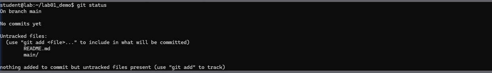
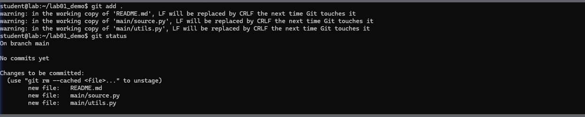
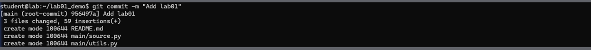
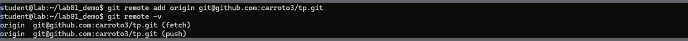
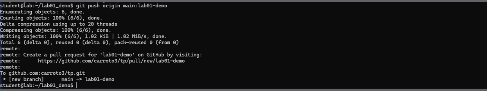

# Лабораторная работа №1 - Git

## Цель работы

Освоить базовые команды Git и научиться работать с локальным и удалённым репозиториями.

## Описание работы

Репозиторий `tp` создан на GitHub. Локальная копия проекта инициализирована, настроены имя и почта автора, добавлен удалённый репозиторий `origin`. Исходный код добавлен в индекс, зафиксирован коммитом «Add lab01» и отправлен на GitHub.

## Структура проекта

Исходный код находится в директории `main/`.

Основные файлы:

- `main/source.py` - точка входа программы;
- `main/utils.py` - вспомогательные функции.

## Ход выполнения

Все шаги повторены на чистой папке `lab01_demo` и сняты на скриншоты. Скриншоты лежат в папке [`screenshots`](screenshots).

### Шаг 1. Инициализация репозитория

```bash
git init
```

Создаёт в текущей папке пустой локальный репозиторий: появляется скрытая директория `.git`, где Git хранит объекты, ветки и настройки.


### Шаг 2. Проверка состояния

```bash
git status
```

Показывает, что коммитов ещё нет, а файлы `README.md` и `main/` не отслеживаются. Git видит их, но в историю они пока не попадут.



### Шаг 3. Добавление файлов в индекс

```bash
git add .
git status
```

`git add .` переносит все файлы из рабочей директории в индекс (staging area). Повторный `git status` подтверждает, что три файла готовы к коммиту. Предупреждения про LF/CRLF - это нормальная реакция Windows-версии Git на окончания строк, на результат они не влияют.



### Шаг 4. Первый коммит

```bash
git commit -m "Add lab01"
```

Фиксирует содержимое индекса как новый коммит `956497a` с сообщением «Add lab01». В выводе видно, что изменилось три файла и добавлено 59 строк.



### Шаг 5. История коммитов

```bash
git log --oneline
```

Показывает компактный список коммитов: `956497a (HEAD -> main) Add lab01`. Сейчас коммит один, и на него указывает `HEAD` ветки `main`.


### Шаг 6. Подключение удалённого репозитория

```bash
git remote add origin git@github.com:carroto3/tp.git
git remote -v
```

`git remote add` привязывает локальный репозиторий к удалённому под именем `origin`, `git remote -v` показывает адрес для чтения (fetch) и записи (push).



### Шаг 7. Отправка коммита на GitHub

```bash
git push origin main:lab01-demo
```

Отправляет локальный коммит в удалённый репозиторий и создаёт там ветку `lab01-demo`. В выводе есть строка `* [new branch]` - значит, ветка появилась на GitHub, и GitHub сразу предложил ссылку на создание pull request.

Ветка `lab01-demo` использована только для демонстрации команды: в `main` этого репозитория уже лежат готовые лабораторные, и перезаписывать её историей демонстрационного проекта нельзя. После снятия скриншота ветка удалена.



## Результат

Локальный репозиторий связан с `git@github.com:carroto3/tp.git`, коммит «Add lab01» отправлен на GitHub. В этом же репозитории размещены следующие лабораторные работы.
