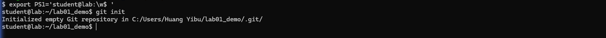
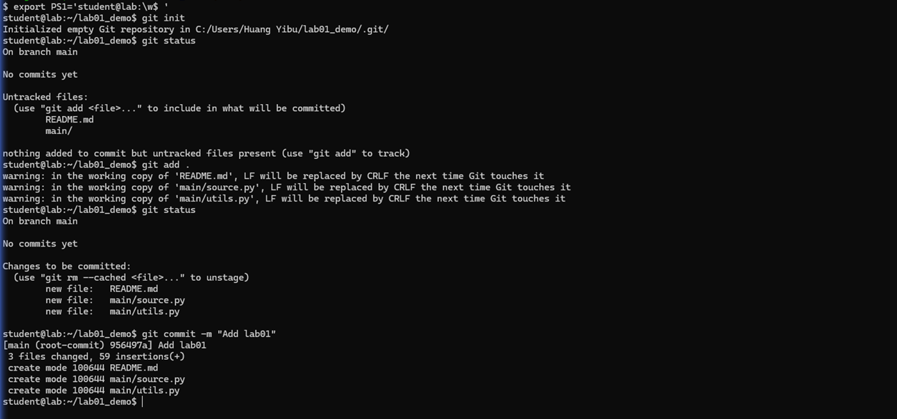
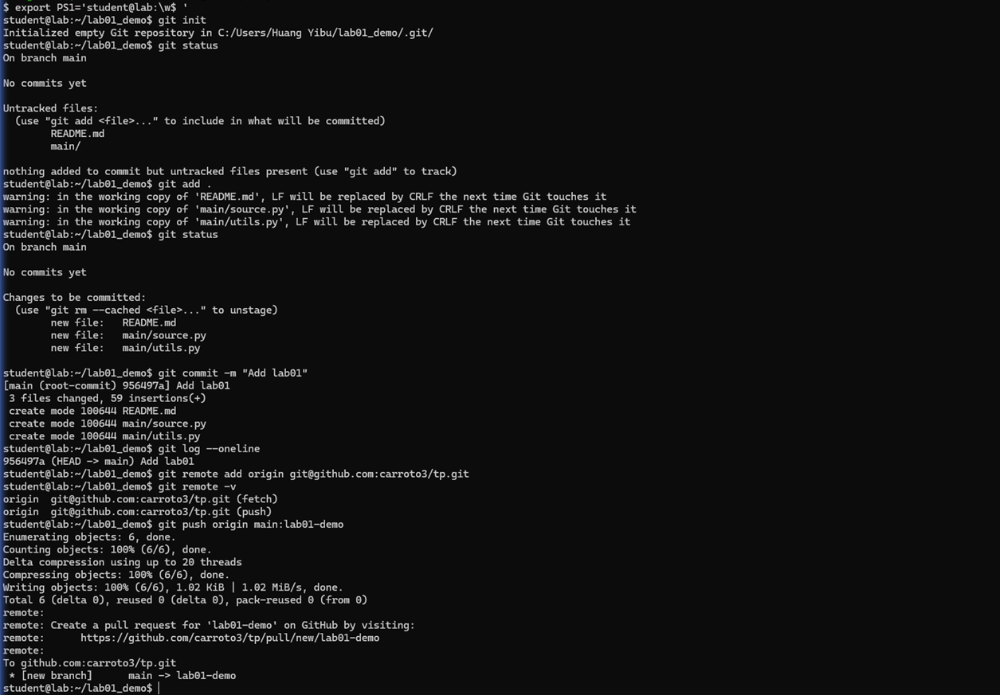

# Лабораторная работа №1 - Git

## Цель работы

Освоить базовые команды Git и научиться работать с локальным и удалённым репозиториями.

## Описание работы

Репозиторий `tp` создан на GitHub. Локальная копия проекта инициализирована, настроены имя и почта автора, добавлен удалённый репозиторий `origin`. Исходный код добавлен в индекс, зафиксирован коммитом «Add lab01» и отправлен на GitHub.

## Структура проекта

Исходный код находится в директории `main/`.

Основные файлы:

- `main/source.py` - точка входа программы;
- `main/utils.py` - вспомогательные функции.

## Выполненные команды

```bash
git init
git config --global user.name "Хуан Ибу"
git config --global user.email "259972030+carroto3@users.noreply.github.com"
git status
git add .
git commit -m "Add lab01"
git log --oneline
git remote add origin git@github.com:carroto3/tp.git
git remote -v
git push -u origin main
```

## Скриншоты выполнения

Прогон команд повторён в чистой папке `lab01_demo`. `push` выполнен в ветку `lab01-demo`, потому что ветка `main` в репозитории уже занята готовыми лабораторными.



`git init` создаёт пустой локальный репозиторий в текущей папке.


`git status` показывает неотслеживаемые файлы `README.md` и `main/`.



`git add .` переносит файлы в индекс, `git commit -m "Add lab01"` фиксирует коммит из трёх файлов.



`git log --oneline` показывает историю, `git remote add origin` подключает удалённый репозиторий, `git push` отправляет коммит на GitHub.

## Результат

Локальный репозиторий связан с `git@github.com:carroto3/tp.git`, коммит «Add lab01» отправлен на GitHub. В этом же репозитории размещены следующие лабораторные работы.
